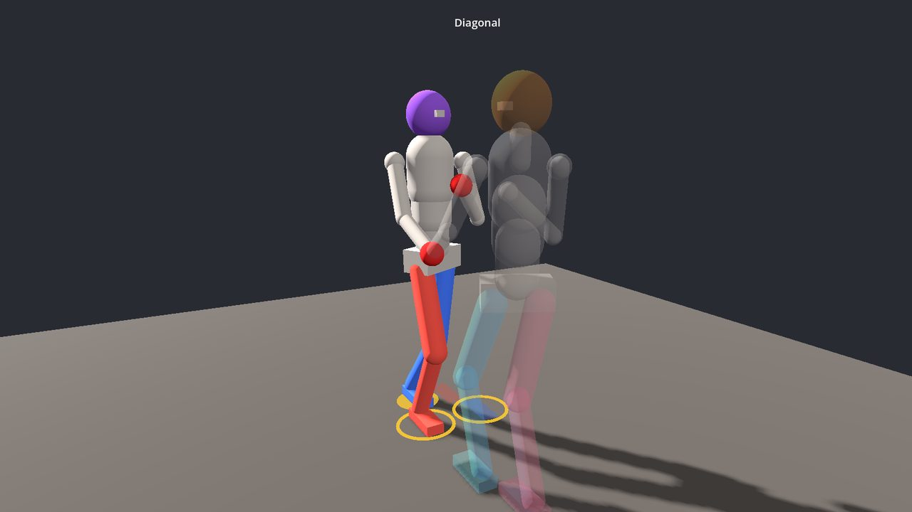
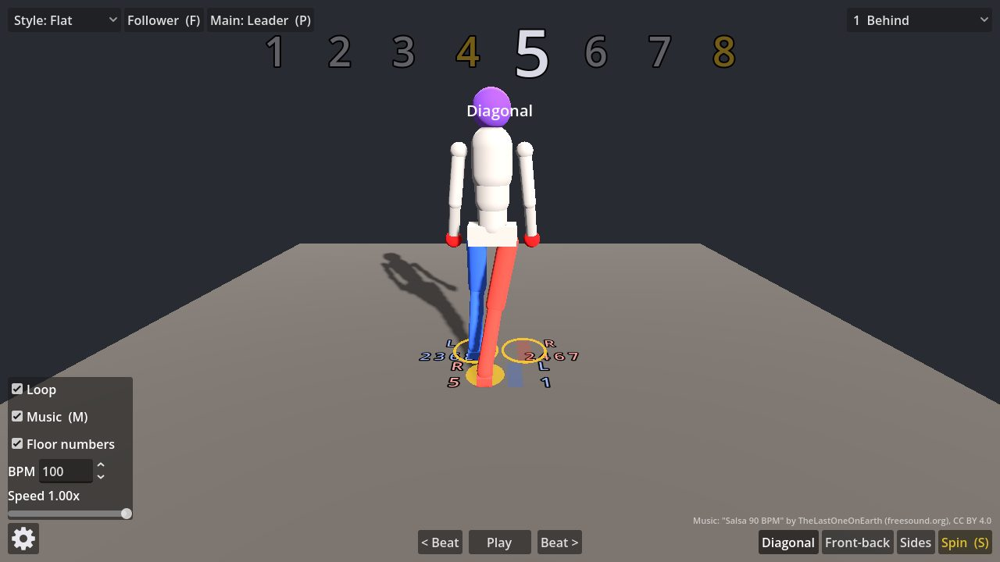
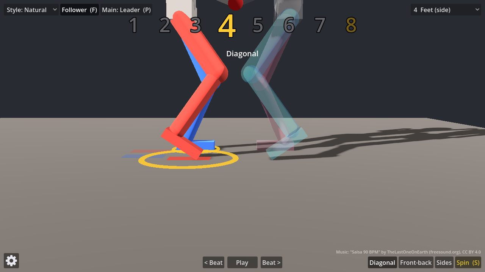
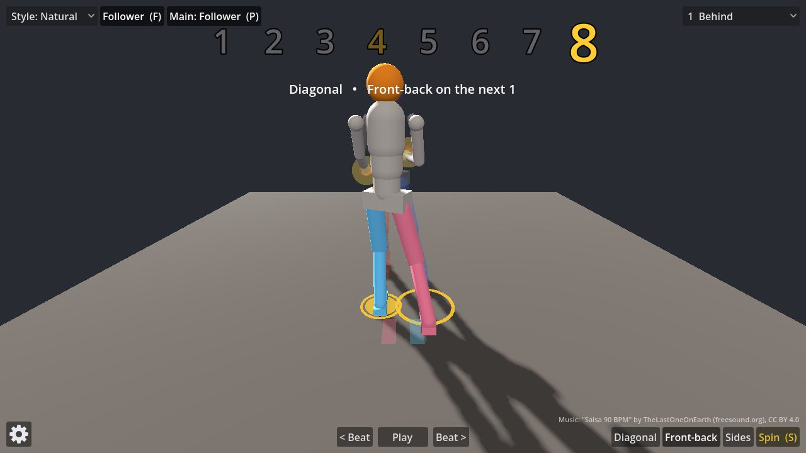

# Enseñalsa

**Learn the salsa basic by watching it, one count at a time.**

Enseñalsa (*enseña* + *salsa*, "teach salsa") is a small 3D practice tool for the salsa basic. A simple figure dances it while the screen counts **1 2 3 4 5 6 7 8** with you. Every count is shown, and the taps on **4** and **8** are highlighted in gold, so you always have something to anchor on.



## What you can do

**Slow it down and step through it.** Play at full tempo, drop to a quarter speed, or pause and glide one count forward or back with the arrow keys. Footprints on the floor show where each foot goes, and a gold disc shows which foot carries the weight. You can switch on the count numbers for each footprint too.



**Pick a basic, and switch on the 1.** Diagonal, Front-back and Sides. Choose another basic at any time: the dancer finishes the current eight counts and changes on the next count 1, never mid-phrase.

**Watch the feet up close.** Eight camera angles, including one from the dancer's own head looking down at the feet and a low side view. The tap lands on the tip of the toes, heel up.



**Dance with a partner.** Turn on the follower and she dances the matching basic in front, holding hands. Switch the **main** dancer to see everything from her side; the other dancer turns see-through. Before a change of basic, the leader prepares on count 8: his hands glow and his arms draw away from the next step, and she is led along.



**Choose a style.** *Flat* shows the footwork alone. *Natural* adds folded arms with fists at the chest and a hip twist on the steps, with the shoulders always square to the front.

**Music or a click.** A looping salsa track keeps time at whatever tempo you pick. Turn it off and you get a click on every count, with a brighter tap sound on 4 and 8.

*Spin* (the yellow button) is experimental: it works, but it still needs tuning.

## Run

**In the editor / desktop:** `godot --path .` (Godot 4.7.x)

**In a browser:**

```bash
./export.sh                                   # writes build/web/
python3 -m http.server 8000 -d build/web      # any static server works
# open http://localhost:8000
```

The export uses the single-threaded web template, so it needs no special COOP/COEP headers. Browsers keep audio muted until the first click or key press.

## Export setup

1. Install Godot **4.7.2** and its export templates (Editor → Manage Export Templates, or extract `web_nothreads_release.zip` from the official `.tpz` into `~/.local/share/godot/export_templates/4.7.2.stable/`).
2. `./export.sh` runs `godot --headless --export-release Web build/web/index.html` using the `Web` preset in `export_presets.cfg`.

## Controls

| Where | Control | Action |
|---|---|---|
| bottom centre | `< Beat` / `Pause` / `Beat >` (← / Space / →) | glide one count back / play-pause / glide one count forward |
| bottom right | `Spin` (S, yellow = experimental) | queue a turn on the next count 1 or 5 (still ahead). Front-back and Sides: the follower turns under the leader's raised right hand. Diagonal: two turns, the leader first, then the follower 4 counts later. Each turn is one full right turn over counts 1-3 (or 5-7), 120° per step, feet closed under the body; the planted foot pivots in place, it never slides |
| bottom right | `Diagonal` / `Front-back` / `Sides` | queue a basic; the dancers switch on the next count 1, and on count 8 before it the leader prepares the change: his hands glow and his arms draw away from the next basic's first step (`prep_reach`, `prep_shoulder`), leading the follower |
| top left | style dropdown | **Flat** (footwork only) or **Natural** (arms folded with elbows at belly and fists at chest height, hips twist with the steps while the shoulders stay square). Switching blends smoothly. |
| top left | Follower toggle (F) | the follower (orange head, sky-blue / coral legs) dances the basic in front of the leader (purple head, red hands), holding hands; cameras centre on the couple |
| top left | Main (P) | whose point of view: cameras, footprints and weight marker follow the main dancer; the other one is see-through |
| top right | camera dropdown (1–8) | behind, front, head-down-to-feet (hips and up hidden), feet close-up from the side, behind 30°, front 30°, behind 45°, front 45° |
| bottom left | gear | Loop (off = stop on count 8), Music (M; when off, every count clicks and tap counts sound a higher tap), Floor numbers (count labels on the footprints, off by default), BPM (default 100), Speed 0.25x–1x |

## How it works

- `data/routine.json` holds **all** values: parameters (home stance, lift, tap height, pelvis height/shift/dip, BPM, music), the basics with their button `labels`, the `start_basic`, and the `styles` (per style: `hip_twist` in radians per metre of front/back foot offset, `arm_forward`, `arm_out`, `elbow`, `forearm_in`; `release_hands` 0 = hands always held, 1 = let go where the basic says; add an entry to add a style). A count may list `free_hands` (the leader's hands that let go on that count in styles that release: Diagonal frees L on 1 and R on 5, Front-back and Sides keep only leader R / follower L holding). `partner_distance` and `hold_drop` place the follower and the held hands. `spins` lists who turns per basic; `spin_closed`, `spin_raise`, `spin_toward`, `spin_lasso` shape the turn and the raised hand. The selected basic loops; picking another one queues it for the next count 1. Each basic is 8 counts. Each count has `weight` (`L`/`R`) and, per foot, `{target: [x, z], action}` with action `step | place | lift | tap | hold`. Coordinates are dancer-local: +X right, +Z forward (the code maps +Z to Godot −Z).
- `scripts/choreo.gd` expands the routine into one state per beat. Within each beat it orders the sub-moves so **weight always leaves a foot before that foot moves**, and a stepping foot moves before it takes weight, so the planted foot never slides. Timing is **square**: every weight change takes the last `weight_phase` of its beat and lands exactly on the count. Moves that have to wait for the weight to leave a foot (lifting it, or bringing it home on 2 and 6) happen in the first `release_phase` of the next beat. A basic always spans counts 1–8, so switches only happen on count 1.
- `scripts/dancer.gd` builds the figure (pelvis → 3 spine segments → neck/head, arms; thighs → shins → feet) and solves each leg with a two-bone IK (law of cosines, knee pole toward the dancer's front). The pelvis moves over the weighted foot when it is at home; on a break step (weighted foot away from home) that shift fades out over `break_distance` and the body follows only `break_follow` of the step, so the leg stretches and the torso stays near neutral. Styles twist the pelvis and counter-rotate the three spine joints so the shoulders stay square. It dips during weight changes and sinks just enough in a wide stance (Sides) that both legs keep a slight bend.
- The follower has her own states per basic, derived from the leader's (`Choreo._follow`: sides swapped, x flipped in her frame). The `follower` map in the data picks the mode per basic: `mirror` (face-to-face: he steps back, she steps back; Diagonal) or `opposite` (he steps forward, she steps back, so the couple moves together; Front-back, Sides). Held hands meet midway between the partners' shoulders, `hold_drop` lower; `Dancer.hold` blends each arm from its style pose to a two-bone arm IK.
- `scripts/main.gd` runs playback on an unwrapped beat clock (8 beats per basic; the queued basic takes over when the clock crosses a count 1), the HUD, footprints (one per target, labelled with its counts; tap targets carry a gold ring that pulses on the tap; a tap lands on the toe tip and rests there until the foot moves), the weight disc, cameras and music.

## Tests

```bash
godot --headless --path . -s res://tests/test_ik.gd       # IK reaches targets, knees bend forward
godot --headless --path . -s res://tests/test_choreo.gd   # every basic switch: no weighted-foot slide, no unreachable target, no jumps, weight lands on the beat
```

## Music

"Salsa 90 BPM" by [TheLastOneOnEarth](https://freesound.org/people/TheLastOneOnEarth/sounds/698660/) (freesound.org), licensed [CC BY 4.0](https://creativecommons.org/licenses/by/4.0/). This is the freesound HQ MP3 preview, unmodified. It loops on its 16-beat grid and is time-stretched to the chosen BPM × speed with pitch preserved. The dance clock follows the audio, and if the music's first beat is not on count 1, set `music_offset` (seconds) in the data file.

## Licence

Code: MIT. The music is under its own CC BY 4.0 licence (see above).
